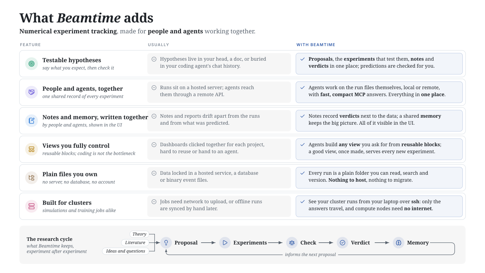

# Beamtime

<picture>
  <source media="(prefers-color-scheme: dark)" srcset="https://raw.githubusercontent.com/hummerichsander/beamtime/main/docs/design/features-dark.svg?v=a114e55e">
  
</picture>

Beamtime keeps track of your numerical experiments (simulations, training runs, parameter scans),
for you and your coding agent.

```sh
pip install 'beamtime[serve]'
beamtime init
```

```python
import beamtime

run = beamtime.init(dir="dt-scan", config={"dt": 1e-3})
for step in range(1000):
    run.log({"energy": simulate_step()})
```

```sh
beamtime serve --open      # your experiments in the browser
beamtime mcp install       # and in Claude Code
```

## Documentation

**[hummerichsander.github.io/beamtime](https://hummerichsander.github.io/beamtime/)**: start with
the [quickstart](https://hummerichsander.github.io/beamtime/quickstart.html), then
[how it works](https://hummerichsander.github.io/beamtime/how-it-works.html). The guides cover
agents, proposals and verdicts, pages, clusters, remote machines, PyTorch Lightning, sharing and
figures, and settings. The same pages are in [`docs/`](docs/index.md).

## License

Apache 2.0. The web interface bundles third-party packages under MIT, ISC, BSD-3-Clause,
Apache-2.0 and Unlicense terms; their licenses ship with it in `THIRD_PARTY_LICENSES.txt`.

## Acknowlegements
The project was developed using agentic LLM systems—specifically Antropic's Claude Code with Opus 
5.5 (October 2026). The code was collaboratively *designed* by humans and LLMs; every single line of
code—including unit and end-to-end tests—was *written* by LLMs. Human-led end-to-end tests are 
running in parallel.