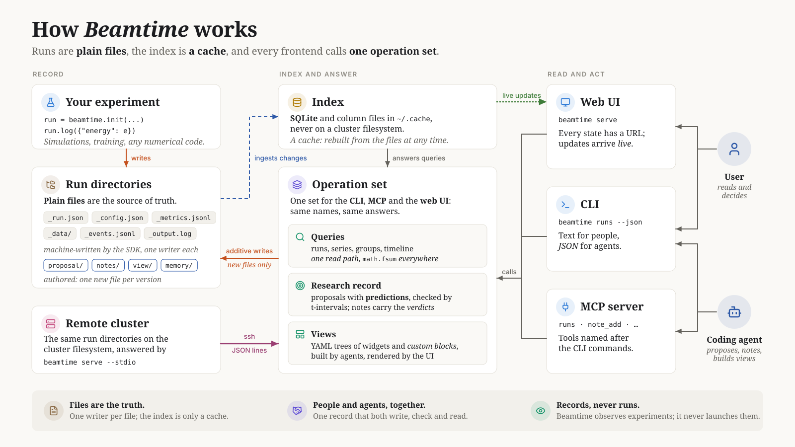

# How it works

## Runs are folders

Each `beamtime.init()` creates a **run**: a folder of plain files (metrics, config, printed output).
Nothing is uploaded; copy, move or delete runs like any folder.

## Groups are folders too

`dir="scaling/lr-sweep"` puts the run in `beamtime/scaling/lr-sweep/`, a **group**. Groups hold runs
and other groups; use one per question.

## A proposal says what you expect

A group's **proposal** states the expectation, e.g. *"lr 3e-4 converges fastest."* Runs started
afterwards record it, and Beamtime can check it against the numbers.

## A verdict says what you found

A **verdict** is confirmed, refuted or inconclusive, with a reason. Groups then show their status:
open, being tested, concluded. See [Proposals and verdicts](guides/research-record.md).

## Pages show it

Each group and run has a page: the main curves, a run table and the notes. A **view** is a page an
agent builds for one question; see [Pages and views](guides/views.md).

## Notes and memory

**Notes** record observations, questions and decisions. A group's **memory** is a short summary
agents read first.

## Agents use the same things

Your agent reads runs, notes and pages through the same operations as the browser and the CLI. It
adds notes and pages but never deletes or moves anything; see [Working with an
agent](guides/agents.md).
