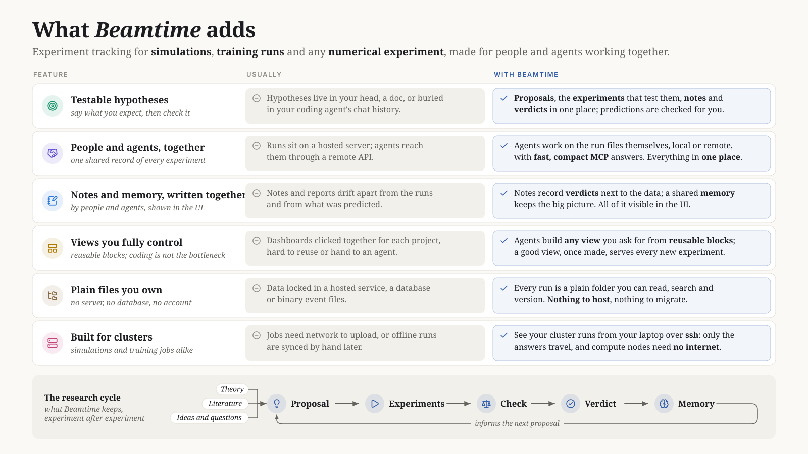

# Beamtime

Beamtime tracks numerical experiments: simulations, training runs, parameter scans. Two lines in
your script log metrics as plain files in your project, shown in your browser, from your laptop or a
cluster. Each experiment starts with what you expect and ends with what you found; your coding agent
reads the same runs and builds pages.

## Start here

1. **[Quickstart](quickstart.md)**: install, log a run, look at it. Five minutes.
2. **[How it works](how-it-works.md)**: runs, groups, proposals and verdicts.

## Go further

- [Setting up a project](guides/setup.md): every setup question, importing past runs, updating.
- [Working with an agent](guides/agents.md): connect Claude Code, Cursor or Codex.
- [Proposals and verdicts](guides/research-record.md): state an expectation, check it, conclude.
- [Pages and views](guides/views.md): a page built for one question.
- [Runs on a cluster](guides/cluster.md): SLURM, preemption, resuming.
- [Remote machines](guides/remotes.md): a cluster's runs next to your laptop's.
- [PyTorch Lightning](guides/lightning.md): one logger for the `Trainer`.
- [Sharing and figures](guides/export.md): a page as a file, charts for a paper.
- [Settings](guides/settings.md): themes, figure styles, where settings live.
- [Command reference](reference/cli.md): every command and its options.
